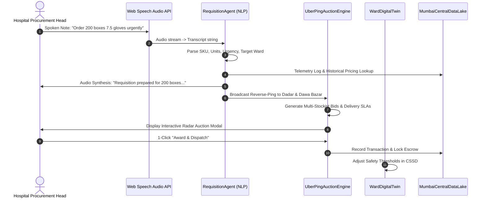

# PulseChain AI — Technical & Domain Architecture

## 1. Domain Deep-Dive: The Mumbai Healthcare Supply Chain

Traditional hospital procurement in the Mumbai Metropolitan Region (MMR) has historically suffered from fragmented distribution channels, information asymmetry, and heavy reliance on manual paperwork or disconnected WhatsApp chats.

### 1.1 The Geographic Corridors of Mumbai MedTech Distribution

```
+-----------------------------------------------------------------------------------------+
|                                    BHIWANDI & THANE                                     |
|                      (Super C&F Depots & Central Freight Hubs)                          |
+--------------------------------------------+--------------------------------------------+
                                             | Bulk Daily Freight (Temp Controlled)
                                             v
+-----------------------------------------------------------------------------------------+
|                            MUMBAI STOCKISTS & DISTRIBUTORS                              |
|  - Princess Street / Dawa Bazar (Kalbadevi): Wholesale syndicate, large bulk catalog     |
|  - Dadar Central Hub (Entero Healthcare / Babuline): Express 45-min intra-city dispatch  |
|  - Andheri West / Link Road (Sagar Medical): Suburban hospital delivery corridor         |
+--------------------------------------------+--------------------------------------------+
                                             | 30 - 90 Min Emergency Intra-City Transit
                                             v
+-----------------------------------------------------------------------------------------+
|                               MUMBAI HOSPITALS & NURSING HOMES                          |
|  - Bandra / Mahim (Lilavati, Hinduja): Tertiary quaternary multi-specialty               |
|  - Parel / Central Mumbai (KEM Hospital): BMC municipal apex facility                   |
|  - Andheri (Kokilaben Dhirubhai Ambani): 750-bed super-specialty                        |
+-----------------------------------------------------------------------------------------+
```

### 1.2 The Working Capital Squeeze (Why 2 Pipes Matter)
- **Hospital Accounts Payable Friction**: Large private and BMC hospitals typically operate on **30 to 90 days credit**.
- **Distributor Liquidity Strain**: Stockists obtain only **15 to 30 days credit** from primary manufacturers (HMD, Poly Medicure, BD).
- **The Solution**: PulseChain AI visualizes this through **two distinct, counter-directional conduits**:
  1. **Physical Goods Conduit (Emerald/Cyan)**: Moving forward from factory production to ward consumption.
  2. **Capital & Payment Conduit (Amber/Gold)**: Moving backwards, utilizing smart escrow factoring and early cash discount incentives (e.g. 2% instant discount on 7-day settlement).

---

## 2. Multi-Agent AI Architecture

The application operates as a **Zero-Form / Zero-Click Native AI system**. Users never touch input forms or dropdown selectors.



### 2.1 The Agentic Personas
1. **`RequisitionAgent`**:
   - Ingests raw conversational strings (Hinglish/English).
   - Extracts: `SKU_ID`, `QUANTITY`, `PACKAGING_UNIT`, `URGENCY_LEVEL`, `DESTINATION_WARD`.
2. **`UberPingAgent`**:
   - Queries verified Mumbai stockist network within radial distance of target hospital.
   - Calculates dynamic transit times considering route corridors (Western Express Highway vs. Eastern Freeway vs. Coastal Road).
   - Generates competitive pricing matrices (Wholesale Rate vs. Express Delivery).
3. **`OnboardingAgent`**:
   - Detects queries from unlisted hospitals or clinics.
   - Triggers voice fallback prompt: *"We don't seem to have you on our database. Please share your name, title, hospital and mobile no..."*
   - Auto-indexes new healthcare providers into the Central Data Lake.
4. **`InventoryForecastingAgent`**:
   - Evaluates daily consumption trends across hospital wards.
   - Automatically computes Reorder Points (ROP) and triggers proactive procurement alerts before stockout.

---

## 3. Real-Time Cross-Device Synchronization

To enable true **Desktop & Mobile App synchronization**:
- The architecture implements a **Reactive State Engine** paired with `BroadcastChannel('mumbai_medpulse_sync')`.
- When an action is taken on the Mobile Companion (e.g. an OT nurse uses 15 boxes of gloves, or places a voice order):
  1. An event is dispatched to the internal event bus.
  2. The Desktop Command Center receives the event in `<20ms` and updates the 2-pipe visualizer, inventory meters, and active order queue.
  3. All transactions are logged to the Mumbai Central Data Lake.

---

## 4. Central Data Lake Schema

Every search query, price discovery, requisition, and ward consumption event streams into the unified Data Lake:

```typescript
interface DataLakeTelemetryEvent {
  id: string;               // Unique log ID (e.g. log-17935394)
  timestamp: string;        // IST time (e.g. "18:14:02")
  source: string;           // Entity (e.g. "Lilavati Hospital & Research Centre")
  event: TelemetryEventType; // 'VOICE_QUERY' | 'STOCKIST_PING' | 'ORDER_DISPATCHED' | 'WARD_CONSUMPTION'
  detail: string;           // Payload description or query prompt
  status: 'RECORDED' | 'PROCESSED' | 'INDEXED';
}
```
